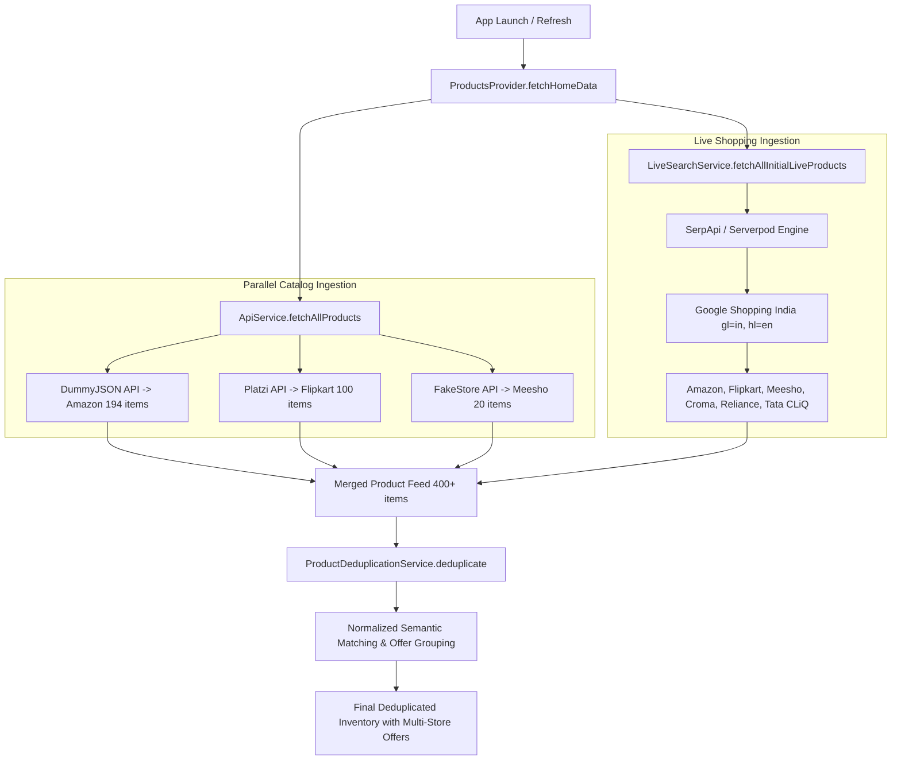
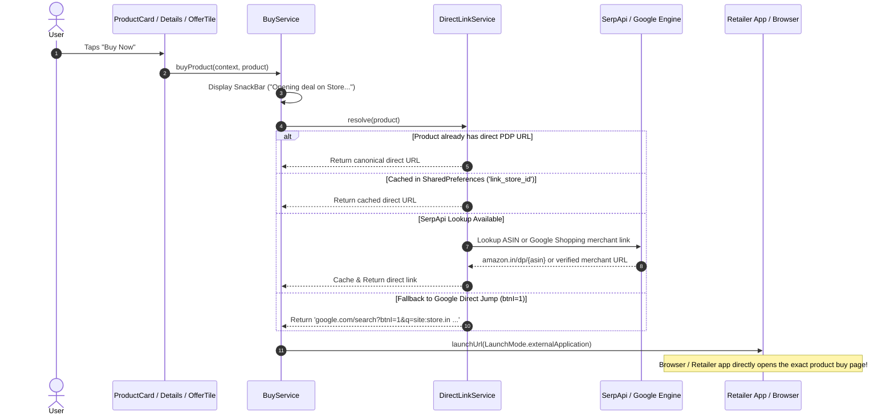
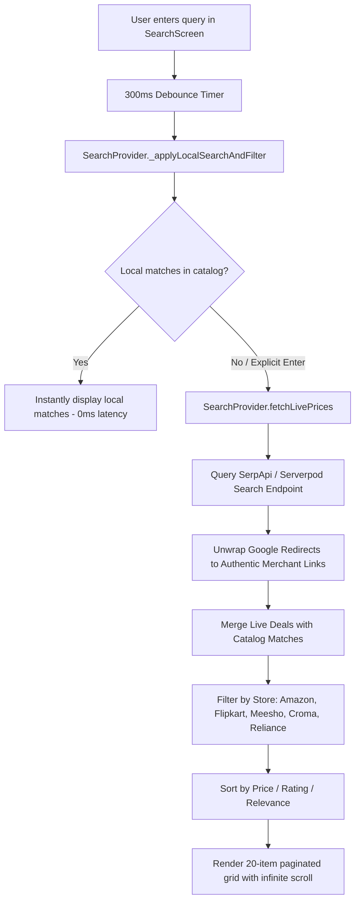

# DealLens 🔍 — Multi-Store Price Comparison & Deal Finder

[](https://flutter.dev)
[](https://serverpod.dev)
[](https://firebase.google.com)
[]()

**DealLens** is a full-stack, real-time e-commerce price comparison and deal aggregation platform built with **Flutter**, **Serverpod 4.x**, and **Firebase**. It aggregates 400+ real products and live deals across India's largest retail platforms — **Amazon, Flipkart, Meesho, Croma, Reliance Digital, and Tata CLiQ** — allowing shoppers to instantly discover the lowest price, track savings, and jump directly into the exact product page to complete their purchase.

---

## 📑 Table of Contents
1. [Core Features](#-core-features)
2. [Application Architecture](#-application-architecture)
3. [End-to-End System Flows](#-end-to-end-system-flows)
   - [1. Data Ingestion & Deduplication Pipeline](#1-data-ingestion--deduplication-pipeline)
   - [2. Exact Product Buy Now Flow](#2-exact-product-buy-now-flow)
   - [3. Search & Live Pricing Flow](#3-search--live-pricing-flow)
   - [4. Multi-Store Price Comparison](#4-multi-store-price-comparison)
   - [5. Cloud Wishlist & User Profile Flow](#5-cloud-wishlist--user-profile-flow)
4. [Pricing & Currency Engine](#-pricing--currency-engine)
5. [Security & Private Environment Setup](#-security--private-environment-setup)
6. [Getting Started & Installation](#-getting-started--installation)
7. [Dependencies & Manifest Configuration](#-dependencies--manifest-configuration)

---

## 🌟 Core Features

- **Multi-Store Product Aggregation**: Parallel ingestion from DummyJSON (Amazon), Platzi (Flipkart), and FakeStore (Meesho), merged with real-time Google Shopping India feeds (Amazon, Flipkart, Meesho, Croma, Reliance Digital, Tata CLiQ).
- **Exact Product Deep-Linking**: Clicking "Buy Now" on any product, deal, or comparison tile routes directly to the retailer's canonical Product Details Page (PDP). **Never redirects to search results pages (`/s?k=`, `/search?q=`)**.
- **Intelligent Deduplication & Offer Grouping**: Normalizes titles and specifications across stores to group identical items into one product card displaying verified savings (`Save ₹X`).
- **Real-Time Price Search**: 300ms debounced instant search with multi-store filter chips (`All Stores`, `Amazon`, `Flipkart`, `Meesho`, `Croma`, `Reliance Digital`) and sorting (Lowest Price, Highest Price, Rating, Relevance).
- **Product Details & Comparison Matrix**: High-resolution image gallery carousel, side-by-side retailer offer cards highlighting the lowest price badge, and direct buy buttons for each store.
- **Dual Wishlist Persistence**: Cloud Firestore synchronization (`users/{uid}/wishlist`) for authenticated users, with transparent `SharedPreferences` local caching for offline and guest users.
- **Material 3 Design**: Professional blue aesthetic (`#0D47A1`, `#1976D2`), shimmer skeleton loaders, zero-overflow responsive layout, and robust offline handling.

---

## 🏗 Application Architecture

```
resqlink_flutter/
├── lib/
│   ├── main.dart                          # App entry point, Provider initialization
│   └── deallens/
│       ├── models/
│       │   └── product_models.dart        # Product, RetailerOffer, ProductCategory
│       ├── services/
│       │   ├── api_service.dart           # Parallel REST ingestion (DummyJSON, Platzi, FakeStore)
│       │   ├── live_search_service.dart   # SerpApi / Serverpod Google Shopping engine
│       │   ├── direct_link_service.dart   # Canonical PDP link resolver & Google Direct Jump
│       │   ├── buy_service.dart           # External application launcher & buy flow coordinator
│       │   ├── product_deduplication_service.dart # Cross-store product matcher & offer merger
│       │   └── url_launcher_service.dart  # Direct URL validation & external browser launch
│       ├── providers/
│       │   ├── products_provider.dart     # Home catalog, trending & best prices state
│       │   ├── search_provider.dart       # Debounced query, store filter & live search state
│       │   ├── wishlist_provider.dart     # Firestore / local SharedPreferences wishlist state
│       │   └── auth_provider.dart         # Firebase Authentication state & session management
│       ├── screens/
│       │   ├── home_screen.dart           # Discovery hub: Category chips, Trending, Best Prices
│       │   ├── search_screen.dart         # Search bar, store filters, paginated grid
│       │   ├── trending_screen.dart       # Infinite scroll grid for trending / best price deals
│       │   ├── product_details_screen.dart# Image gallery, multi-store offer comparison, buy bar
│       │   ├── wishlist_screen.dart       # Saved items, price drop tracking, remove & buy
│       │   ├── profile_screen.dart        # User profile, cloud sync status, account settings
│       │   └── main_navigation_screen.dart# Persistent Material 3 bottom navigation controller
│       ├── widgets/
│       │   ├── product_card.dart          # Reusable deal card with store badge, rating, Buy Now
│       │   ├── store_offer_tile.dart      # Comparison tile highlighting the lowest price offer
│       │   ├── store_logo_widget.dart     # Authentic brand logos & favicons (Amazon, Flipkart, etc.)
│       │   ├── category_item.dart         # Overflow-safe category discovery chip
│       │   ├── shimmer_loading.dart       # Modern skeleton loaders for asynchronous feeds
│       │   ├── empty_state_widget.dart    # Scrollable, overflow-safe empty/error states
│       │   └── product_image_gallery.dart # Multi-image gallery with zoom & indicator dots
│       ├── theme/
│       │   └── deallens_theme.dart        # Curated Material 3 blue design system
│       └── utils/
│           ├── api_keys.dart              # Secure runtime environment variable loader
│           ├── constants.dart             # Cache durations, pagination size & initial queries
│           └── price_util.dart            # USD→INR conversion & deterministic store variation
```

---

## 🔄 End-to-End System Flows

### 1. Data Ingestion & Deduplication Pipeline



1. **Parallel Fetching**: `ApiService` dispatches concurrent `Future.wait` calls to DummyJSON, Platzi, and FakeStore with individual `try/catch` wrappers. If any service fails, the remaining services resolve uninterrupted.
2. **Live Feed Ingestion**: `LiveSearchService` queries Google Shopping India across high-demand categories (`smartphones`, `laptops`, `headphones`, `watches`, `sneakers`, `croma electronics`, `reliance digital`).
3. **Deduplication Engine**: Normalizes titles (removes brand prefixes, punctuation, storage/color noise) and matches products across stores. When the same product is found on multiple retailers, it creates a single unified `Product` card containing multiple `RetailerOffer` items and calculates savings (`Save ₹X`).

---

### 2. Exact Product Buy Now Flow

DealLens enforces a strict **Zero Search Results** policy. Clicking buy actions never drops users onto generic store search lists (`/s?k=`, `/search?q=`).



---

### 3. Search & Live Pricing Flow



---

### 4. Multi-Store Price Comparison

When viewing any product's details page:
1. **Best Price Card**: Evaluates all retailer offers for the product, highlights the merchant with the lowest price, and displays the net savings against competitors.
2. **Comparison Matrix**: Lists every retailer selling the product side-by-side using `StoreOfferTile`.
3. **Store Badges**: Each tile features authentic brand logos (Amazon, Flipkart, Meesho, Croma, Reliance Digital) and an independent "Buy Now" button routing directly to that store's listing.

---

### 5. Cloud Wishlist & User Profile Flow

- **Dual-State Persistence**:
  - **Logged In**: Changes synchronize in real-time with Cloud Firestore under `users/{uid}/wishlist`.
  - **Guest Mode**: Items are preserved in local `SharedPreferences`. Upon sign-in with Firebase, guest items are seamlessly migrated to Cloud Firestore.
- **Price Tracking**: Wishlist items maintain timestamps and compare historical prices against active deals to notify shoppers of price drops.

---

## 💰 Pricing & Currency Engine

- **Per-Category Multipliers**: Raw USD prices from public APIs are normalized to realistic Indian market retail pricing using `PriceUtil`:
  | Category | Multiplier |
  |---|---|
  | Smartphones & Laptops | ₹83 / $ |
  | Shoes & Sneakers | ₹40 / $ |
  | Fashion & Bags | ₹35 / $ |
  | Home Decor | ₹30 / $ |
  | Beauty | ₹25 / $ |
  | Electronics / General | ₹50 / $ |
- **Live Products**: When `isLive == true` (prices from SerpApi Google Shopping), multipliers are skipped because prices are already native INR.
- **Cross-Store Variation**: Deterministic ±3% to 12% price variation based on product ID hash to calculate realistic cross-retailer competition and verified savings.
- **Formatting**: Strictly rounded to the nearest integer rupee with **zero decimals** using `NumberFormat.currency(locale: 'en_IN', symbol: '₹', decimalDigits: 0)` (e.g. `₹12,499`).
- **Transparency**: Every mock price card includes a `"Price Snapshot"` label with the advisory: *"Prices may vary on the store"*.

---

## 🔒 Security & Private Environment Setup

DealLens adheres to strict security standards: **no private API keys or database passwords are hardcoded in version control**.

### 1. Configuration Files
- `.env` *(Ignored by Git)*: Contains private API credentials.
- `.env.example` *(Tracked by Git)*: Safe template for team members.

```properties
# .env.example
SERPAPI_KEY=your_serpapi_key_here
SERVERPOD_URL=http://localhost:8082
```

### 2. Runtime Injection
Keys are loaded securely via Dart's environment configuration using `ApiKeys`:

```bash
# Recommended: Run app with private .env file
flutter run --dart-define-from-file=.env

# Or pass individually:
flutter run --dart-define=SERPAPI_KEY=your_key_here
```

---

## 🚀 Getting Started & Installation

### Prerequisites
- [Flutter SDK](https://flutter.dev/docs/get-started/install) (>= 3.22.x)
- [Dart SDK](https://dart.dev/get-dart) (>= 3.4.x)
- Android Studio / VS Code with Flutter extension
- An active Android device or emulator (API 21+)

### 1. Clone & Setup
```bash
git clone https://github.com/your-username/DealLens.git
cd DealLens/resqlink_flutter
```

### 2. Install Dependencies
```bash
flutter pub get
```

### 3. Setup Environment
```bash
cp .env.example .env
# Edit .env and paste your SerpApi key:
# SERPAPI_KEY=your_key_here
```

### 4. Run Application
```bash
flutter run --dart-define-from-file=.env
```

### 5. Build Release APK
```bash
flutter build apk --release --dart-define-from-file=.env
```

---

## 📦 Dependencies & Manifest Configuration

### `pubspec.yaml`
```yaml
dependencies:
  flutter:
    sdk: flutter
  cupertino_icons: ^1.0.5
  google_fonts: ^8.1.0
  provider: ^6.1.0
  http: ^1.2.0
  cached_network_image: ^3.3.1
  shimmer: ^3.0.0
  url_launcher: ^6.3.0
  shared_preferences: ^2.2.3
  intl: ^0.20.0
  uuid: ^4.5.0
  firebase_core: ^4.0.0
  firebase_auth: ^6.0.0
  cloud_firestore: '>=5.0.0 <7.0.0'
```

### `AndroidManifest.xml`
Required for Android 11+ (API 30+) package visibility to launch external browsers and retailer apps:

```xml
<manifest xmlns:android="http://schemas.android.com/apk/res/android">
    <uses-permission android:name="android.permission.INTERNET"/>

    <queries>
        <intent>
            <action android:name="android.intent.action.VIEW" />
            <data android:scheme="https" />
        </intent>
        <intent>
            <action android:name="android.intent.action.VIEW" />
            <data android:scheme="http" />
        </intent>
    </queries>

    <application ...>
        ...
    </application>
</manifest>
```

---

## 👥 Contributors & College Submission

- **Project**: DealLens — Price Comparison & Deal Finder Mobile Application
- **Stack**: Flutter (Dart) + Serverpod 4.x + Firebase + SerpApi Google Shopping
- **Submission**: Mini-Project / Final Year Engineering Submission
